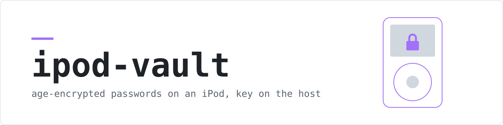

<div align="center">

<picture>
  <source media="(prefers-color-scheme: dark)" srcset="docs/assets/banner-dark.svg">
  
</picture>

# ipod-vault

### age-encrypted passwords on an iPod, key on the host

**Your passwords live on a removable iPod as age ciphertext. You open them in an fzf picker, and a coding agent can pipe one into a command without it reaching the transcript.**

[](LICENSE)
[](#quick-start)
[](bin/vault)
[](https://age-encryption.org)
[](CONTRIBUTING.md)

[Quick start](#quick-start) · [Usage](#usage) · [Agent recipes](#agent-recipes) · [How it works](#how-it-works) · [Security and limits](#security-and-limits)

<code>git clone https://github.com/minomat180/ipod-vault && cd ipod-vault && ./install.sh</code>

<br><br>


<sub>Recorded against a throwaway vault from <a href="docs/demo/setup.sh"><code>docs/demo/setup.sh</code></a>: a fresh age key and five fake entries in a temp directory.</sub>

</div>

---

ipod-vault is a password vault for one person on Linux. The vault is a single
[age](https://age-encryption.org) file on an iPod and the key is in the host's
keyring, so neither half is enough on its own. It is a few hundred lines of
Bash with no daemon and no state besides those two things.

- **The iPod holds only ciphertext.** `vault/vault.age` is the only vault file
  on the iPod, a plain FAT32 drive with no key on it. Whoever finds it has an
  encrypted blob.
- **The host holds only the key.** The age private key and its public recipient
  are items in the gnome-keyring login collection (`service=ipod-vault`),
  created by `install.sh`. Without the iPod there is nothing to decrypt.
- **No decrypted vault file is ever written.** `vault` decrypts into a pipe or a
  shell variable, edits rows with `awk`, and re-encrypts to a temp file on the
  iPod that is renamed over `vault.age`. A copied password is cleared from the
  Wayland clipboard after 45 seconds.
- **Agents get a pipe, not a value.** A coding agent (I use Claude Code) runs
  `vault decrypt`, picks one row with `awk` and pipes the password into the one
  command that needs it, so the value is not in the transcript or in any
  process's argv.
- **The iPod is found by label.** It tends to come back as a different
  `/dev/sdX` after a replug; `vault` looks it up by the `IPOD` filesystem label
  and replaces a stale mount instead of failing.

> [!NOTE]
> The pipe-only rule is a convention the agent follows, not a mechanism.
> Nothing redacts output: an agent that pipes the password into `cat` has
> leaked it. [`docs/SECURITY.md`](docs/SECURITY.md) spells out what the design
> covers and what it does not.

## Quick start

| Needs | |
| --- | --- |
| OS | Linux with a Wayland session |
| Secret Service | gnome-keyring, unlocked at login |
| Packages | `age`, `libsecret` (`secret-tool`), `fzf`, `wl-clipboard`, `libnotify`, `util-linux` |
| Rights | `sudo` for `mkdir`, `mount` and `umount` |

```bash
git clone https://github.com/minomat180/ipod-vault ~/Projects/ipod-vault
cd ~/Projects/ipod-vault
./install.sh    # checks dependencies, creates the age key in the keyring,
                # links vault and genpass.sh into ~/bin
```

`~/bin` has to be on your `PATH`. `install.sh` is safe to re-run; it keeps an
existing key.

> [!IMPORTANT]
> Back the key up right away
> ([`docs/SECURITY.md`](docs/SECURITY.md#back-up-your-key)). If the keyring
> item is lost, the vault cannot be decrypted.

Give the iPod's FAT32 data partition the filesystem label `IPOD` (for example
`sudo fatlabel /dev/sdX2 IPOD`), plug it in and run `vault`. It mounts the
partition at `/mnt/ipod`, decrypts and opens the picker.

## Usage

### The picker

| Key     | Action                                        |
|---------|-----------------------------------------------|
| enter   | copy the password, clear the clipboard in 45s |
| alt-u   | copy the username                             |
| alt-e   | edit the entry                                |
| alt-d   | delete the entry (asks first)                 |
| alt-a   | add an entry (generated or typed password)    |
| esc     | quit                                          |

### Commands

```bash
vault                     # the picker
vault ls                  # labels, usernames and dates; never passwords
vault add web/example     # add; offers a generated 32-character password
vault edit web/example
vault rm web/example
vault get web/example     # copy the password (--user: username, --show: print both)
vault import < rows.tsv   # add label<TAB>user<TAB>pass rows; same label replaces
vault decrypt             # plaintext to stdout, for pipes
vault mount
vault umount
```

### Environment

Four variables change where things are, which is how the demo runs without an
iPod or a keyring:

| Variable              | Default         | Purpose                                       |
|-----------------------|-----------------|-----------------------------------------------|
| `IPOD_VAULT_MOUNT`    | `/mnt/ipod`     | mount point                                   |
| `IPOD_VAULT_LABEL`    | `IPOD`          | filesystem label to look for                  |
| `IPOD_VAULT_DIR`      | `<mount>/vault` | use this directory; skips mounting            |
| `IPOD_VAULT_IDENTITY` | keyring item    | age identity file instead of the keyring      |

### Password generator

`vault add` uses `bin/genpass.sh`, which also works on its own. Character
passwords are drawn from `/dev/urandom` with rejection sampling, so every
character in the set is equally likely. Passphrase mode picks words with a
plain modulo over 32 random bits (off from uniform by less than one part in
ten thousand for a wordlist under 400,000 words) and appends a number from 0
to 99 that is not uniform, so count its strength by the words alone.

```bash
genpass.sh                # 32 of the 94 printable ASCII characters (about 210 bits)
genpass.sh -l 20 -n 3     # three 20-character passwords
genpass.sh -s -l 24       # letters and digits only
genpass.sh -p list        # presets: paypal, short20, pin, simple16
genpass.sh -w             # six-word passphrase (needs /usr/share/dict/words)
```

## Agent recipes

The rules an agent follows: list labels freely; a password only ever travels
through a pipe into one command (on stdin, or as an environment variable set
inside `sh -c`); never print, echo, store or encode it. The agent's own
permission prompt is the only approval step, so it says which entry it reads
and why before it runs the command.

```bash
# list labels
vault decrypt | awk -F'\t' 'NF>=4 && $1!~/^#/ {print $1}'

# one password into one command on stdin
vault decrypt \
  | awk -F'\t' -v l=web/example '$1==l {p=$3} END {if (p=="") exit 1; printf "%s", p}' \
  | some-cli login --password-stdin

# one password as an environment variable, never in argv
vault decrypt \
  | awk -F'\t' -v l=db/staging '$1==l {p=$3} END {if (p=="") exit 1; printf "%s", p}' \
  | sh -c 'PGPASSWORD=$(cat) psql -h db.example.internal -U app -c "select 1"'
```

The `awk` exits non-zero when the label does not exist, so with
`set -o pipefail` a mistyped label shows up as a failed pipeline instead of
passing silently. On a machine without the iPod, a copy of `vault.age` and an
identity file work the same way: `age -d -i <identity> vault.age` replaces
`vault decrypt`.

## How it works

```text
  host (Linux)                                 iPod (FAT32, label IPOD)
  +----------------------------+               +---------------------------+
  | gnome-keyring              |               | vault/vault.age           |
  |   age private key          |               |   age ciphertext          |
  |        |                   |    age -d     |                           |
  |        v                   | <------------ |   (only vault file)       |
  | bin/vault                  |               |                           |
  |   plaintext in pipes and   |    age -r     |                           |
  |   shell variables only     | ------------> | temp file, renamed over   |
  |                            |               | vault.age                 |
  +----------------------------+               +---------------------------+
```

Decrypted, the vault is a tab-separated file, one entry per line:

```text
# label        username    password    date
web/example    demo-user   ...         2026-08-25
```

| File | Role |
| --- | --- |
| [`bin/vault`](bin/vault) | CLI and fzf picker, about 300 lines |
| [`bin/genpass.sh`](bin/genpass.sh) | password and passphrase generator |
| [`install.sh`](install.sh) | dependency check, keypair into the keyring, `~/bin` links |
| [`docs/SECURITY.md`](docs/SECURITY.md) | threat model, key backup and restore |
| [`docs/demo/`](docs/demo) | throwaway demo vault and the VHS tape for the GIF |

## Security and limits

It holds my own passwords. It is a personal tool, not a product.

> [!WARNING]
> **No protection against code running as you.** While the keyring is
> unlocked, any process of your user can read the key and decrypt the vault
> without a prompt. With an identity file instead of the keyring, the same
> holds for anything that can read that file.

> [!WARNING]
> **Decrypted data is in memory, and memory is not sealed.** Bash variables can
> be paged to an unencrypted swap partition. wl-copy keeps a copied password in
> a temp file under `$TMPDIR` (or `/tmp`) until the clipboard is cleared, so
> `/tmp` should be a tmpfs. A clipboard history manager may keep its own copy.

- **Linux only.** Mounting uses `blkid` and `findmnt`, copying uses
  `wl-clipboard`. On macOS I read the vault with `age` and an identity file.
- **No sync, no history.** There is one `vault.age`; back it up yourself.
- **No automated tests.** The scripts pass `shellcheck` and were checked by
  hand against the demo vault.

Found a security problem? See [`docs/SECURITY.md`](docs/SECURITY.md#reporting-a-problem).

## License

MIT, see [LICENSE](LICENSE). Encryption is [age](https://github.com/FiloSottile/age)
by Filippo Valsorda; the picker is [fzf](https://github.com/junegunn/fzf).
